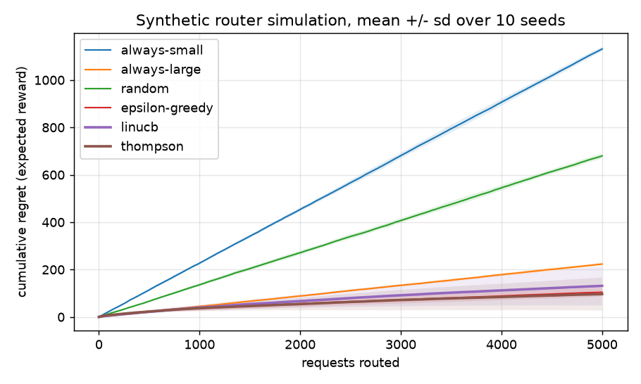

| policy | quality | cost / request | reward / request | final cum. regret | share sent to large |
|---|---|---|---|---|---|
| always-small | 0.449 | 0.100 | 0.419 | 1130.9 +/- 9.6 | 0.00 |
| always-large | 0.901 | 1.000 | 0.601 | 223.3 +/- 6.7 | 1.00 |
| random | 0.674 | 0.551 | 0.509 | 679.7 +/- 11.7 | 0.50 |
| epsilon-greedy | 0.849 | 0.750 | 0.624 | 104.5 +/- 18.3 | 0.72 |
| linucb | 0.872 | 0.845 | 0.619 | 131.3 +/- 82.8 | 0.83 |
| thompson | 0.870 | 0.812 | 0.626 | 96.6 +/- 69.3 | 0.79 |

What I read from it:

- Always-small is cheap and bad. Random lands in between, as it should.
- Always-large is a strong baseline here because the large model succeeds about 90 percent of the time and the cost penalty is moderate. Its regret still grows steadily, because it pays for the large model on easy requests.
- LinUCB, Thompson sampling and epsilon-greedy all send 72 to 83 percent of traffic to the large model, get a similar reward per request (0.62 to 0.63 against 0.60 for always-large), and end with 43 to 59 percent of the regret of always-large.
- I cannot rank the three learners. Their final regrets overlap given the spread across seeds (the standard deviation is large for LinUCB and Thompson). On this simulator, simple epsilon-greedy was as good as the other two.

## Limits

- It is a simulation I designed. The gap between the models, the cost ratio and the features all come from me, so the results depend on those choices.
- The true success probability is a sigmoid, but the learners fit a linear model on reward, so they are misspecified. I did not measure how much that costs them.
- Only two arms, one cost penalty, and a stationary world. No drift, no delayed feedback, and no real quality signal (in practice quality is hard to measure).
- No hyperparameter search and no confidence intervals beyond the standard deviation across 10 seeds.

## What I would do next

Replace the simulator with logged quality scores from two real models on a public prompt set, using a judge or a benchmark with answers. Then evaluate offline with the logged data, add a latency term to the reward, and try a non-stationary stream.
